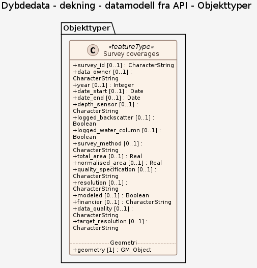

### Datamodell - datamodell fra API

➡️ [Se full datamodell for omfang "datamodell fra API" (diagram per pakke og objektkatalog)](datamodell-fra-api/objektkatalog.html)

### Datamodell - UML

➡️ [Se full datamodell for omfang "UML" (diagram per pakke og objektkatalog)](uml/objektkatalog.html)
